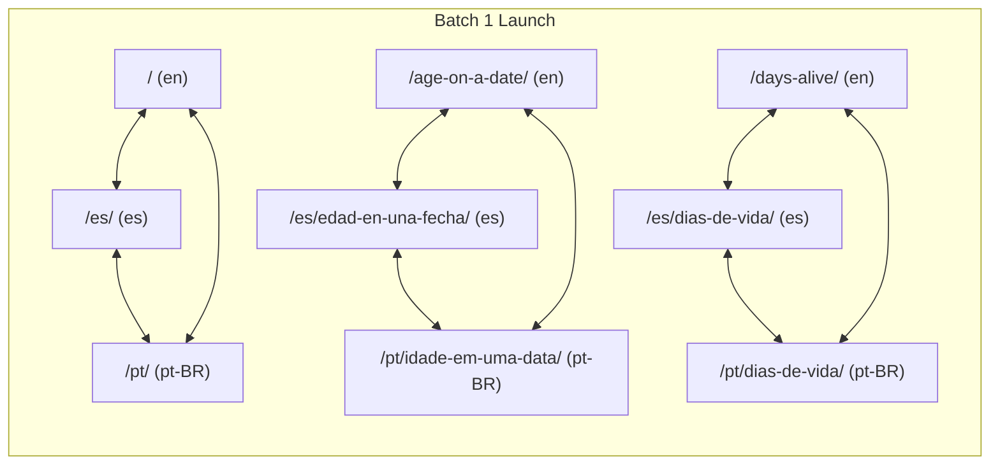

# Multilingual Keyword-to-URL Map (Canonical Architecture)

This document establishes the canonical keyword-to-URL mapping for **Age & Date Calculator** across three target markets: **English (`en`)**, **Spanish (`es`, Neutral Latin American)**, and **Brazilian Portuguese (`pt-BR`)**. 

### Architectural Principles
1. **One Primary Intent per URL:** Strict prevention of internal keyword cannibalization.
2. **Standardized Slug Syntax:** Localized, lowercase, unaccented, hyphen-separated with mandatory trailing slash.
3. **SERP Snippet Compliance:** All page titles are $\le 60$ characters with the primary keyword positioned at or near the beginning. Meta descriptions are $\le 155$ characters.
4. **Phased Rollout Strategy:**
   - **Launch Batch 1:** Main Calculator (`/`, `/es/`, `/pt/`), Age on a Specific Date, and Days Alive.
   - **Launch Batch 2:** Days Between Dates, Birthday Countdown, Half-Birthday, Dog/Pet Age, and Age Difference (launched only when paired with rich, unique on-page educational content).

---

## 1. English Market (`en` — Global / US / India)

| Canonical URL | Primary Keyword | Secondary Keywords | Search Intent | Page Title ($\le$ 60 chars) | Main H1 | Launch Batch |
| :--- | :--- | :--- | :--- | :--- | :--- | :---: |
| `/` | `age calculator` | • `calculate age`<br>• `how old am I`<br>• `age calculator by date of birth`<br>• `exact age calculator`<br>• `chronological age calculator` | Calculational: Current chronological age in discrete units and life milestones | `Age Calculator: How Old Am I? (Years, Months and Days)` *(54 chars)* | `Age Calculator: How Old Am I Today?` | **Batch 1** |
| `/age-on-a-date/` | `age on a specific date` | • `age as on date calculator`<br>• `calculate age on a future date`<br>• `how old will I be on`<br>• `age cutoff calculator for exams`<br>• `how old was I on this date` | Calculational / Administrative: Eligibility verification for exams, cutoffs, retirement | `Age on a Specific Date Calculator: Cutoff & Past Age` *(52 chars)* | `Age on a Specific Date Calculator` | **Batch 1** |
| `/days-alive/` | `days alive calculator` | • `how many days old am I`<br>• `how many days have I been alive`<br>• `10000 days old`<br>• `how many hours have I been alive`<br>• `calculate days of life` | Calculational / Milestone: Total days lived, vital benchmarks, and 10,000-day celebration | `Days Alive Calculator: How Many Days Old Are You?` *(49 chars)* | `Days Alive Calculator: Exactly How Many Days Have You Lived?` | **Batch 1** |
| `/days-between-dates/` | `days between dates calculator` | • `how many days between two dates`<br>• `date difference calculator`<br>• `working days between two dates`<br>• `business days calculator`<br>• `days between dates inclusive` | Calculational / Duration: Elapsed duration, calendar days, and business day intervals | `Days Between Dates Calculator: Calendar & Work Days` *(51 chars)* | `Days Between Dates Calculator` | **Batch 2** |
| `/birthday-countdown/` | `birthday countdown` | • `how many days until my birthday`<br>• `days until next birthday`<br>• `months and days until birthday`<br>• `birthday day of the week` | Calculational / Ticker: Live real-time ticking countdown to upcoming birthday | `Birthday Countdown: Exact Days, Hours & Minutes` *(47 chars)* | `Birthday Countdown: Days Until Your Next Birthday` | **Batch 2** |
| `/half-birthday-calculator/` | `half birthday calculator` | • `when is my half birthday`<br>• `6 months from my birthday`<br>• `half birthday meaning`<br>• `halfway to birthday date` | Calculational / Milestone: Exact calendar date 6 months from birth | `Half Birthday Calculator: Find Your 6-Month Mark` *(48 chars)* | `Half Birthday Calculator: When Is Your Half Birthday?` | **Batch 2** |
| `/dog-age-calculator/` | `dog years calculator` | • `dog age in human years`<br>• `cat age calculator`<br>• `how old is my dog in human years`<br>• `dog years chart by weight`<br>• `veterinary pet age calculator` | Calculational / Veterinary: Multi-stage physiological conversion for dogs and cats | `Dog Years Calculator: Accurate Human Age Conversion` *(52 chars)* | `Dog Years to Human Years Calculator` | **Batch 2** |
| `/age-difference-calculator/` | `age difference calculator` | • `age gap calculator`<br>• `how many years difference between two ages`<br>• `age gap between two people`<br>• `calculate age difference` | Calculational / Comparative: Chronological age gap between two birthdates | `Age Difference Calculator: Compare Exact Age Gap` *(48 chars)* | `Age Difference Calculator: Compare Age Gap Between Two People` | **Batch 2** |

---

## 2. Spanish Market (`es` — Neutral Latin American)

| Canonical URL | Primary Keyword | Secondary Keywords | Search Intent | Page Title ($\le$ 60 chars) | Main H1 | Launch Batch |
| :--- | :--- | :--- | :--- | :--- | :--- | :---: |
| `/es/` | `calculadora de edad` | • `calcular edad`<br>• `cuántos años tengo`<br>• `calcular edad exacta`<br>• `calcular edad por fecha de nacimiento`<br>• `calcular edad cronologica` | Calculational: Current chronological age for administrative and personal use | `Calculadora de Edad: ¿Cuántos Años Tengo? (Edad Exacta)` *(55 chars)* | `Calculadora de Edad: ¿Cuántos Años Tengo Hoy?` | **Batch 1** |
| `/es/edad-en-una-fecha/` | `calcular edad en una fecha` | • `edad a una fecha determinada`<br>• `calcular edad en una fecha específica`<br>• `cuantos anos tendre en tal fecha`<br>• `edad cumplida a una fecha`<br>• `calculadora fecha de corte` | Calculational / Administrative: Cutoff dates for school enrollment, tenders, passports | `Calcular Edad en una Fecha: Fechas Límite y Trámites` *(51 chars)* | `Calcular Edad en una Fecha Determinada` | **Batch 1** |
| `/es/dias-de-vida/` | `calcular días de vida` | • `cuántos días tengo de vida`<br>• `cuantos dias he vivido`<br>• `10000 dias de vida`<br>• `cuántas horas he vivido`<br>• `calculadora de dias vividos` | Calculational / Milestone: Total days lived on Earth and milestone celebrations | `Calculadora de Días de Vida: ¿Cuántos Días Has Vivido?` *(53 chars)* | `Calculadora de Días de Vida: Descubre Cuántos Días Tienes` | **Batch 1** |
| `/es/dias-entre-fechas/` | `calcular días entre dos fechas` | • `cuántos días hay entre dos fechas`<br>• `calculadora de fechas`<br>• `dias habiles entre dos fechas`<br>• `dias naturales vs dias habiles`<br>• `diferencia entre dos fechas` | Calculational / Duration: Elapsed calendar days and business days (*términos procesales*) | `Calcular Días Entre Dos Fechas: Días Hábiles y Total` *(52 chars)* | `Calcular Días Entre Dos Fechas` | **Batch 2** |
| `/es/cuenta-regresiva-cumpleanos/` | `cuenta regresiva cumpleaños` | • `cuántos días faltan para mi cumpleaños`<br>• `cuanto falta para mi cumple`<br>• `contador de dias para mi cumpleaños`<br>• `proximo cumpleaños` | Calculational / Ticker: Live countdown to next birthday celebration | `Cuenta Regresiva de Cumpleaños: ¿Cuánto Falta?` *(46 chars)* | `Cuenta Regresiva para Tu Próximo Cumpleaños` | **Batch 2** |
| `/es/medio-cumpleanos/` | `calculadora de medio cumpleaños` | • `cuándo es mi medio cumpleaños`<br>• `medio cumpleaños fecha`<br>• `6 meses despues de mi cumpleaños`<br>• `celebrar medio cumpleaños` | Calculational / Milestone: Exact calendar date 6 months from birthdate | `Calculadora de Medio Cumpleaños: Fecha a 6 Meses` *(48 chars)* | `Calculadora de Medio Cumpleaños: Cuándo es Tu Medio Cumpleaños` | **Batch 2** |
| `/es/edad-del-perro/` | `edad de perro en años humanos` | • `calculadora de edad de perro`<br>• `edad de gato en años humanos`<br>• `tabla de edad de perros por tamaño`<br>• `años perrunos a humanos` | Calculational / Veterinary: AVMA-aligned conversion for dogs and cats | `Edad de Perro en Años Humanos: Calculadora Veterinaria` *(53 chars)* | `Calculadora de Edad de Perro en Años Humanos` | **Batch 2** |
| `/es/diferencia-de-edad/` | `diferencia de edad entre dos personas` | • `calculadora de diferencia de edad`<br>• `calcular diferencia de edad entre dos fechas`<br>• `brecha de edad entre parejas`<br>• `quién es mayor y por cuánto` | Calculational / Comparative: Chronological difference and age gap between two individuals | `Diferencia de Edad: Calculadora de Brecha Temporal` *(50 chars)* | `Calculadora de Diferencia de Edad Entre Dos Personas` | **Batch 2** |

---

## 3. Brazilian Portuguese Market (`pt-BR`)

| Canonical URL | Primary Keyword | Secondary Keywords | Search Intent | Page Title ($\le$ 60 chars) | Main H1 | Launch Batch |
| :--- | :--- | :--- | :--- | :--- | :--- | :---: |
| `/pt/` | `calculadora de idade` | • `calcular idade`<br>• `quantos anos eu tenho`<br>• `calcular idade exata`<br>• `calcular idade pela data de nascimento`<br>• `como calcular a idade cronologica` | Calculational: Current chronological age for official registration and documents | `Calculadora de Idade: Quantos Anos Eu Tenho? (Idade Exata)` *(57 chars)* | `Calculadora de Idade: Quantos Anos Eu Tenho Hoje?` | **Batch 1** |
| `/pt/idade-em-uma-data/` | `calcular idade em uma data` | • `idade em data específica`<br>• `calcular idade em determinada data`<br>• `idade para concurso publico na data da posse`<br>• `quantos anos eu tinha em tal ano`<br>• `idade limite concurso publico` | Calculational / Administrative: Cutoff dates for Brazilian civil service (*concursos públicos*) and pensions | `Calcular Idade em uma Data: Concursos e Documentos` *(50 chars)* | `Calcular Idade em uma Data Específica` | **Batch 1** |
| `/pt/dias-de-vida/` | `calcular dias de vida` | • `quantos dias eu tenho de vida`<br>• `quantos dias já vivi`<br>• `10000 dias de vida calcular`<br>• `quantas horas de vida eu tenho`<br>• `calculadora de dias vividos` | Calculational / Milestone: Total days lived on Earth and 10,000-day celebrations | `Calculadora de Dias de Vida: Quantos Dias Já Viveu?` *(51 chars)* | `Calculadora de Dias de Vida: Descubra Quantos Dias Você Tem` | **Batch 1** |
| `/pt/dias-entre-datas/` | `calcular dias entre duas datas` | • `quantos dias entre duas datas`<br>• `calculadora de datas`<br>• `dias úteis entre duas datas`<br>• `dias corridos vs dias uteis`<br>• `calculadora prazo processual cpc` | Calculational / Duration: Elapsed calendar days and business days (*prazos processuais CPC / aviso prévio*) | `Calcular Dias Entre Duas Datas: Dias Úteis e Corridos` *(53 chars)* | `Calcular Dias Entre Duas Datas` | **Batch 2** |
| `/pt/contagem-regressiva-aniversario/` | `contagem regressiva aniversário` | • `quantos dias faltam para meu aniversário`<br>• `quanto tempo falta para meu aniversario`<br>• `contador de aniversário`<br>• `dias até o próximo aniversário` | Calculational / Ticker: Live countdown to next birthday | `Contagem Regressiva de Aniversário: Dias e Horas` *(48 chars)* | `Contagem Regressiva para Seu Próximo Aniversário` | **Batch 2** |
| `/pt/meio-aniversario/` | `calculadora de meio aniversário` | • `quando é meu meio aniversário`<br>• `meio aniversário data`<br>• `mesversário 6 meses`<br>• `comemoração meio aniversário` | Calculational / Milestone: Exact calendar date 6 months from birthdate | `Calculadora de Meio Aniversário: Marco de 6 Meses` *(49 chars)* | `Calculadora de Meio Aniversário: Quando é Seu Meio Aniversário?` | **Batch 2** |
| `/pt/idade-do-cachorro/` | `idade do cachorro em anos humanos` | • `calculadora de idade de cachorro`<br>• `idade de gato em anos humanos`<br>• `como calcular idade de cachorro porte pequeno medio grande`<br>• `tabela idade de cachorro` | Calculational / Veterinary: Veterinary physiological curves by breed size | `Idade do Cachorro em Anos Humanos: Guia Veterinário` *(51 chars)* | `Calculadora de Idade do Cachorro em Anos Humanos` | **Batch 2** |
| `/pt/diferenca-de-idade/` | `diferença de idade entre duas pessoas` | • `calculadora de diferença de idade`<br>• `diferença de idade entre datas`<br>• `calcular diferença de idade de casal`<br>• `quem é mais velho diferença de dias` | Calculational / Comparative: Chronological difference and age gap between two individuals | `Diferença de Idade Entre Duas Pessoas: Calculadora` *(50 chars)* | `Calculadora de Diferença de Idade Entre Duas Pessoas` | **Batch 2** |

---

## 4. Hreflang Alignment Matrix Across Launch Batches

Each URL maintains strict reciprocal 1:1 hreflang annotations across languages:



### Self-Referencing Canonical & Hreflang Tags Specification
For example, on `/age-on-a-date/`:
```html
<link rel="canonical" href="https://yourdomain.com/age-on-a-date/" />
<link rel="alternate" hreflang="en" href="https://yourdomain.com/age-on-a-date/" />
<link rel="alternate" hreflang="es" href="https://yourdomain.com/es/edad-en-una-fecha/" />
<link rel="alternate" hreflang="pt-BR" href="https://yourdomain.com/pt/idade-em-uma-data/" />
<link rel="alternate" hreflang="x-default" href="https://yourdomain.com/age-on-a-date/" />
```
*(Only published URLs in the current batch are included in the live hreflang cluster to avoid 404 indexing errors).*

