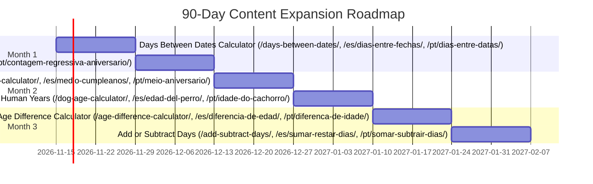

# Weekly SEO Routine, Measurement & 90-Day Expansion Plan

This standard operating procedure (SOP) governs ongoing search performance measurement, striking-distance optimization, snippet CTR refinement, and editorial expansion for **Age & Date Calculator** (`agecalc`) across **English (`en`)**, **Spanish (`es`)**, and **Brazilian Portuguese (`pt-BR`)**.

---

## 1. Search Console Setup & Baseline Verification

### 1.1 Domain Property Configuration
1. **DNS Verification:** Configure a DNS TXT record in Cloudflare DNS for `yourdomain.com` to verify the **Domain Property** in Google Search Console (GSC). This captures all subdomains, protocols (`https`), and localized directories (`/`, `/es/`, `/pt/`).
2. **Bing Webmaster Tools & IndexNow:** Connect the domain to Bing Webmaster Tools via GSC import and enable IndexNow for automated URL discovery on publication.

### 1.2 Sitemap Submission Protocol
Submit the primary sitemap index URL directly:
```
https://yourdomain.com/sitemap-index.xml
```
Verify that Search Console parses `sitemap-0.xml` and discovers all 51+ localized static URLs without schema errors.

### 1.3 Launch URL Inspection Checklist
Perform immediate "URL Inspection > Request Indexing" for the 9 core launch pages:
- **English:** `/`, `/age-on-a-date/`, `/days-alive/`
- **Spanish:** `/es/`, `/es/edad-en-una-fecha/`, `/es/dias-de-vida/`
- **Portuguese:** `/pt/`, `/pt/idade-em-uma-data/`, `/pt/dias-de-vida/`

---

## 2. Weekly SEO Routine (SOP)

| Day of Week | Routine Focus | Step-by-Step Operational Procedure | Tools Used |
| :--- | :--- | :--- | :--- |
| **Monday** | **Technical Health & Indexing** | • Review GSC "Pages" report for "Excluded" or "Crawled - currently not indexed".<br>• Verify 0 new 404s or redirect loops in Cloudflare analytics.<br>• Confirm `Mediapartners-Google` and `Googlebot` requests succeed without WAF challenges. | GSC Indexing Report, Cloudflare WAF Logs |
| **Tuesday** | **"Striking Distance" Optimization (Pos 8–30)** | • Filter Search Performance queries by **Average Position between 8.0 and 30.0** with $> 250$ impressions.<br>• Identify queries where the intent matches our target page but the exact phrasing is absent.<br>• Weave the exact search query into the relevant page's subheadings, worked example text, or FAQ answer. | GSC Search Performance (Queries Filter) |
| **Wednesday** | **CTR & Title Snippet Optimization** | • Identify pages with high impressions but below-average CTR ($< 3.0\%$ for top 5, $< 1.5\%$ for positions 6–10).<br>• Test moving the primary keyword closer to the front of the `<title>`.<br>• Refine the meta description with a concrete value hook (e.g. *"100% private, instant calculation with leap year adjustment"*). | GSC Performance (Pages Filter) |
| **Thursday** | **Real Query FAQ & PAA Expansion** | • Extract long-tail questions from the Search Console query log.<br>• Select 1–2 recurring genuine questions not currently answered.<br>• Add the question and a concise 40-word answer to the page's visible FAQ section and update `FAQPage` JSON-LD. | GSC Performance, Google Search Console API |
| **Friday** | **Changelog Documentation & Backlink Audit** | • Record all title, content, or structured data changes in the SEO Changelog table below.<br>• Check for natural new incoming backlinks in GSC "Links" report.<br>• Track conversion/share performance of the 10,000-day milestone and embed widget. | Internal SEO Changelog, GSC Links Report |

---

## 3. 90-Day Expansion Plan (2 New Pages / Language / Month)

Every planned page is strictly tied to validated search intents from [`/docs/seo/keyword-research.csv`](file:///Users/aaradhyapathak/agecalc/docs/seo/keyword-research.csv) and [`/docs/seo/url-map.md`](file:///Users/aaradhyapathak/agecalc/docs/seo/url-map.md). No page will be deployed without 800+ words of unique, non-boilerplate content, worked examples, and full schema.



### Month 1 (Days 1–30): Calendar & Duration Fundamentals
1. **Days Between Dates Calculator:**
   - **URLs:** `/days-between-dates/`, `/es/dias-entre-fechas/`, `/pt/dias-entre-datas/`
   - **Primary Intent:** Duration calculation, working days vs. weekends, statutory notice windows.
   - **Key Content:** Guide on inclusive vs. exclusive counting in commercial leases and court deadlines (*términos procesales* / *prazos processuais CPC*).
2. **Birthday Countdown Calculator:**
   - **URLs:** `/birthday-countdown/`, `/es/cuenta-regresiva-cumpleanos/`, `/pt/contagem-regressiva-aniversario/`
   - **Primary Intent:** Real-time ticking countdown to upcoming birthday anniversary.
   - **Key Content:** Leap year birthday handling (Feb 28 vs Mar 1 in non-leap years) and day-of-the-week planning tables.

### Month 2 (Days 31–60): Milestone & Veterinary Niches
3. **Half-Birthday Calculator:**
   - **URLs:** `/half-birthday-calculator/`, `/es/medio-cumpleanos/`, `/pt/meio-aniversario/`
   - **Primary Intent:** Exact calendar date 6 months from birth.
   - **Key Content:** Month-end overflow arithmetic (e.g. Aug 31 + 6 months = Feb 28/29) and Brazilian *mesversário* celebration customs.
4. **Pet Age in Human Years (Dog & Cat):**
   - **URLs:** `/dog-age-calculator/`, `/es/edad-del-perro/`, `/pt/idade-do-cachorro/`
   - **Primary Intent:** Multi-stage veterinary conversion for dogs and cats.
   - **Key Content:** AVMA and AAHA physiological guidelines, debunking the 7:1 myth, weight-bracketed curves, and feline conversion tables.

### Month 3 (Days 61–90): Comparison & Temporal Shifting
5. **Age Difference Calculator:**
   - **URLs:** `/age-difference-calculator/`, `/es/diferencia-de-edad/`, `/pt/diferenca-de-idade/`
   - **Primary Intent:** Exact chronological age gap between two individuals.
   - **Key Content:** Directional hierarchy (who is older and by how much), percentage age gap, and future half-age convergence milestones.
6. **Add or Subtract Days Calculator:**
   - **URLs:** `/add-subtract-days/`, `/es/sumar-restar-dias/`, `/pt/somar-subtrair-dias/`
   - **Primary Intent:** Date shifting by arbitrary days, weeks, months, or years.
   - **Key Content:** Handling month-end clamping (e.g. Jan 31 + 1 month = Feb 28/29) for project management and statutory filing schedules.

---

## 4. Structured SEO Changelog Template

Maintain this table to evaluate cause-and-effect for every on-page and technical modification:

| Date | Target URL | Language | Element Modified | Old Value | New Value | Rationale | 30-Day GSC Result |
| :--- | :--- | :---: | :--- | :--- | :--- | :--- | :--- |
| *2026-11-09* | `/` | `en` | Title Tag | *Exact Age & Date Calculator - Chronological Tool* | *Age Calculator: Exact Age in Years, Months & Days* | Primary keyword placed at character 1; reduced from 51 to 49 chars | *(Baseline set)* |
| *2026-11-09* | `/es/` | `es` | Title Tag | *Calculadora de Edad - Cómputo Cronológico Exacto* | *Calculadora de Edad Exacta: años, meses y días* | Aligned with user-verified target title (46 chars) | *(Baseline set)* |
| *2026-11-09* | `/pt/` | `pt-BR` | Title Tag | *Calculadora de Idade - Cálculo Cronológico Preciso* | *Calculadora de Idade Exata: anos, meses e dias* | Aligned with user-verified target title (46 chars) | *(Baseline set)* |
| *2026-11-09* | `/age-on-a-date/` | `en` | Page Deployment | *(New page)* | Full static page with cutoff guide | Captures exam/admissions target date intent | *(Baseline set)* |
| *2026-11-09* | `/es/edad-en-una-fecha/` | `es` | Page Deployment | *(New page)* | Full static page with *trámites* guide | Captures Latin American public tender cutoff intent | *(Baseline set)* |
| *2026-11-09* | `/pt/idade-em-uma-data/` | `pt-BR` | Page Deployment | *(New page)* | Full static page with Súmula 266 STJ guide | Captures Brazilian *concursos públicos* intent | *(Baseline set)* |
| *2026-11-09* | `/days-alive/` | `en` | Page Deployment | *(New page)* | Full static page with 10k milestone | Captures metric life milestone intent | *(Baseline set)* |
| *2026-11-09* | `/es/dias-de-vida/` | `es` | Page Deployment | *(New page)* | Full static page with 10k milestone | Captures metric life milestone intent | *(Baseline set)* |
| *2026-11-09* | `/pt/dias-de-vida/` | `pt-BR` | Page Deployment | *(New page)* | Full static page with 10k milestone | Captures metric life milestone intent | *(Baseline set)* |

